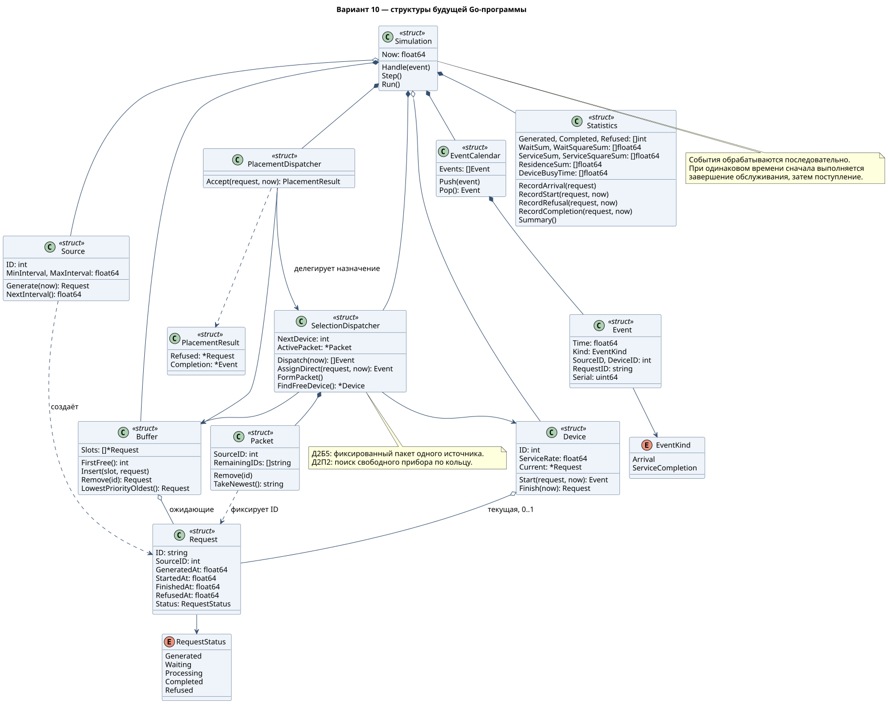
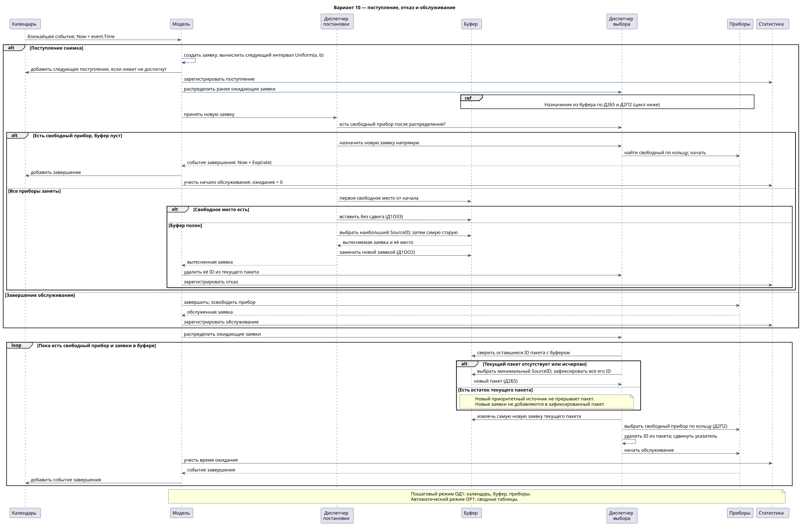
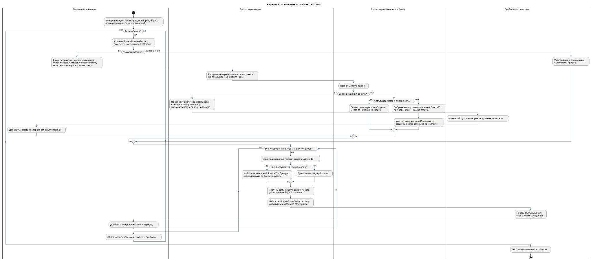
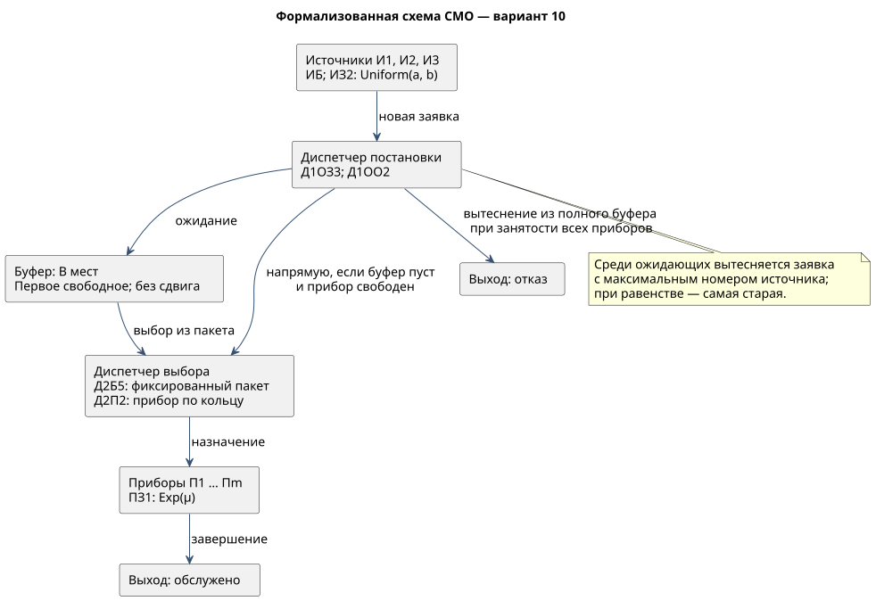

# Система обработки снимков с камер наблюдения — вариант 10

**Комаров М. А. · группа 5130904/40102**

Курсовая работа по имитационному моделированию. Вариант 10. Этап проектирования модели на Go.

## Формула варианта

`ИБ · ИЗ2 · ПЗ1 · Д1ОЗ3 · Д1ОО2 · Д2П2 · Д2Б5 · ОР1 · ОД1`

| Код | Значение |
|---|---|
| ИБ | Бесконечные источники |
| ИЗ2 | Равномерное распределение интервалов поступления |
| ПЗ1 | Экспоненциальное распределение времени обслуживания |
| Д1ОЗ3 | Первое свободное место от начала буфера, без сдвига |
| Д1ОО2 | Вытеснение ожидающей заявки наименее приоритетного источника |
| Д2П2 | Выбор свободного прибора по кольцу |
| Д2Б5 | Выбор заявок фиксированными пакетами по приоритету источника |
| ОР1 | Сводные таблицы результатов |
| ОД1 | Календарь событий, буфер и текущее состояние |

## Бизнес-домен

Моделируется сервер видеоаналитики склада. Камеры на въезде, погрузочной площадке и стоянке формируют снимки. Ограниченное число программных обработчиков анализирует их. Если все обработчики заняты, снимки ожидают в общем конечном буфере. При переполнении вытесняются ожидающие снимки наименее приоритетного источника.

В модели снимок представлен заявкой. Рассчитываются время ожидания, вероятность отказа и загрузка обработчиков.

| Источник | Место установки | Приоритет |
|---|---|---|
| И1 | Въезд | Высший |
| И2 | Погрузочная площадка | Средний |
| И3 | Стоянка | Низший |

## Маппинг

| Элемент СМО | Элемент домена | Назначение |
|---|---|---|
| Источник | Камера | Создаёт заявки с равномерными интервалами |
| Заявка | Снимок | Содержит ID, источник и временные отметки |
| Буфер | Места памяти сервера | Хранит ожидающие снимки без сдвига |
| Прибор | Программный обработчик | Обрабатывает один снимок; время экспоненциально |
| Диспетчер постановки | Модуль приёма и размещения | Решает: непосредственное обслуживание или буфер; организует вытеснение |
| Диспетчер выбора | Модуль назначения | Фиксирует пакет и выбирает свободный обработчик по кольцу |
| Отказ | Удаление ожидающего снимка | Учитывается в статистике |
| Обслуживание | Условный анализ снимка | Заканчивается событием завершения |
| Выход | Обслуженный или отклонённый снимок | Покидает систему |

Правила работы и параметры модели: [model-rules.md](docs/model-rules.md).

## Первичные артефакты

### 1. Диаграмма структур

Диаграмма содержит структуры программы, их поля, методы и связи.

[Исходник PlantUML](docs/diagrams/structure.puml)

### 2. Диаграмма последовательности

Поступление, прямое назначение, постановка в буфер, вытеснение, завершение обслуживания и назначение из пакета.

[Исходник PlantUML](docs/diagrams/sequence.puml)

### 3. Блок-схема с дорожками

Моделирование по особым событиям, размещение, отказ и повторное назначение заявок на свободные приборы.

[Исходник PlantUML](docs/diagrams/flowchart.puml)

## Формализованное описание

### Формализованная схема СМО

[Исходник](docs/diagrams/formal-scheme.puml)

### Временная диаграмма

[Пошаговая таблица и пояснения](docs/timeline.md) · [CSV](docs/timeline-events.csv)
