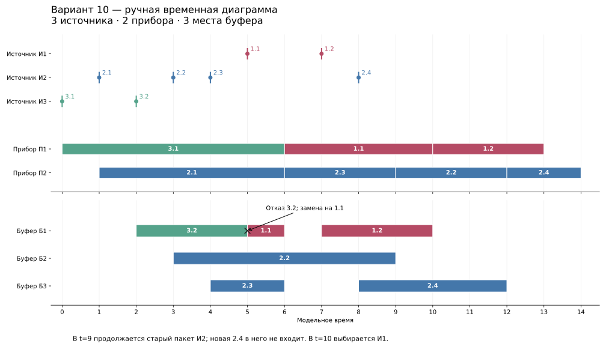

# Временная диаграмма

Три источника, два прибора, три места буфера. Обозначение `i.k` — k-я заявка источника i. Меньший номер источника означает более высокий приоритет.

Для построения диаграммы заданы фиксированные моменты поступления и длительности обслуживания. Интервалы между повторными поступлениями каждого источника находятся в пределах [1; 10]. Время первого поступления каждого источника задано отдельно. Пример показывает работу дисциплин варианта и не используется для статистической оценки.

## Состояние после каждого события

| t | Событие | Б1 | Б2 | Б3 | П1 | П2 | Остаток пакета | Указатель |
|---|---|---|---|---|---|---|---|---|
| 0 | Приход 3.1 → П1 | — | — | — | 3.1 до 6 | свободен | — | 2 |
| 1 | Приход 2.1 → П2 | — | — | — | 3.1 до 6 | 2.1 до 6 | — | 1 |
| 2 | Приход 3.2 → Б1 | 3.2 | — | — | 3.1 до 6 | 2.1 до 6 | — | 1 |
| 3 | Приход 2.2 → Б2 | 3.2 | 2.2 | — | 3.1 до 6 | 2.1 до 6 | — | 1 |
| 4 | Приход 2.3 → Б3 | 3.2 | 2.2 | 2.3 | 3.1 до 6 | 2.1 до 6 | — | 1 |
| 5 | Приход 1.1; отказ 3.2 | 1.1 | 2.2 | 2.3 | 3.1 до 6 | 2.1 до 6 | — | 1 |
| 6 | Конец П1; пакет И1; 1.1 → П1 | — | 2.2 | 2.3 | 1.1 до 10 | 2.1 до 6 | И1: пуст | 2 |
| 6 | Конец П2; пакет И2; 2.3 → П2 | — | 2.2 | — | 1.1 до 10 | 2.3 до 9 | И2: {2.2} | 1 |
| 7 | Приход 1.2 → Б1 | 1.2 | 2.2 | — | 1.1 до 10 | 2.3 до 9 | И2: {2.2} | 1 |
| 8 | Приход 2.4 → Б3; вне пакета | 1.2 | 2.2 | 2.4 | 1.1 до 10 | 2.3 до 9 | И2: {2.2} | 1 |
| 9 | Конец П2; 2.2 → П2 | 1.2 | — | 2.4 | 1.1 до 10 | 2.2 до 12 | И2: пуст | 1 |
| 10 | Конец П1; новый пакет И1; 1.2 → П1 | — | — | 2.4 | 1.2 до 13 | 2.2 до 12 | И1: пуст | 2 |
| 12 | Конец П2; новый пакет И2; 2.4 → П2 | — | — | — | 1.2 до 13 | 2.4 до 14 | И2: пуст | 1 |
| 13 | Конец П1 | — | — | — | свободен | 2.4 до 14 | — | 1 |
| 14 | Конец П2; система пуста | — | — | — | свободен | свободен | — | 1 |

## Разбор событий

- **Д1ОЗ3:** в t=2, 3, 4 заняты последовательно Б1, Б2, Б3. В t=7 новая заявка занимает освободившееся Б1, остальные не сдвигаются.
- **Д1ОО2:** в t=5 все приборы и места заняты. Из буфера вытесняется 3.2 — заявка наименее приоритетного источника. Пришедшая 1.1 занимает её место. Отказ определяется среди уже находящихся в буфере заявок.
- **Д2Б5:** в t=6 формируется пакет {2.2, 2.3}. Более новая 2.3 уходит первой. В t=9 выбирается оставшаяся 2.2, хотя в буфере уже есть более приоритетная 1.2. Пришедшая в t=8 заявка 2.4 не входит в старый пакет.
- **Смена пакета:** в t=10 выбирается новый пакет И1, хотя 2.2 ещё обслуживается на П2. Завершения всех обслуживаемых заявок прошлого пакета ждать не требуется.
- **Д2П2:** указатель после назначения на П2 возвращается к П1. В t=9 П1 занят: поиск пропускает его и назначает заявку П2.
- **Равные времена:** два завершения в t=6 обработаны по номеру прибора, с распределением после каждого события.

Поступило 8 заявок; обслужено 7; отказано 1. В конце буфер и приборы пусты. Для каждого момента выполняется баланс: поступило = обслужено + отказано + в буфере + на приборах.

Таблица событий в формате CSV: [timeline-events.csv](timeline-events.csv).
